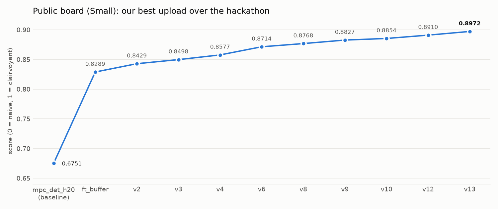
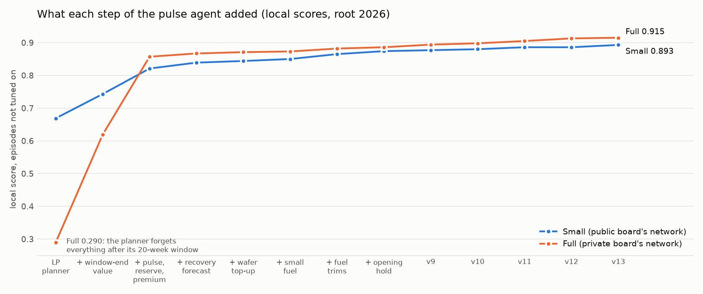
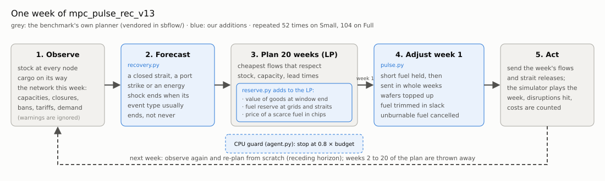
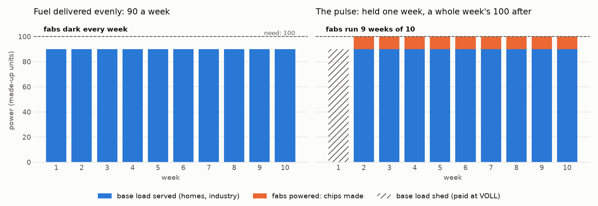
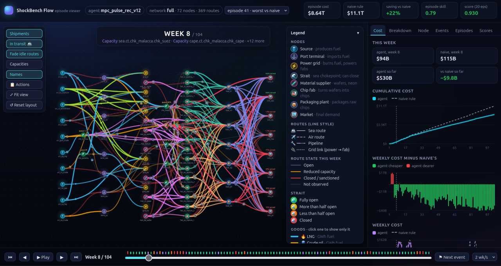
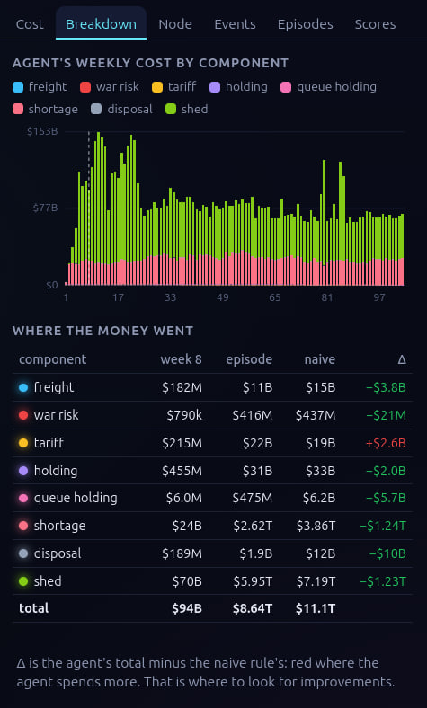
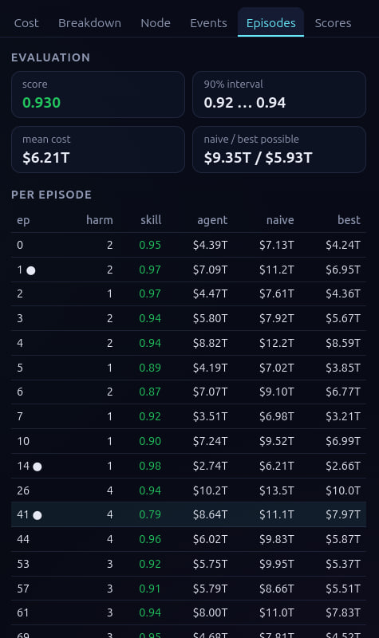
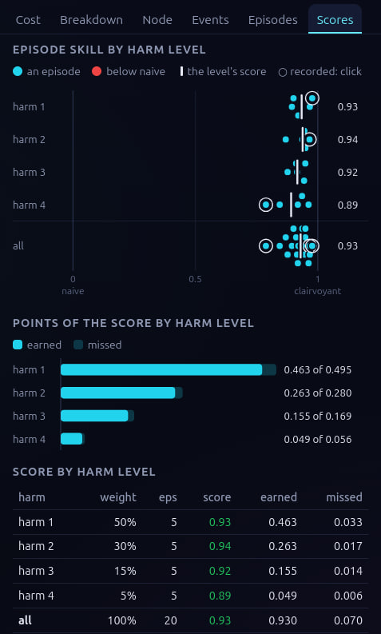

# Secrethon 2026: keeping a supply network running while the map breaks

By team **Пельмені з сиром без грибів**: our solution to **ShockBench-Flow**, the control task of the Secrethon 2026 hackathon. Every week an agent decides how
much fuel, wafers and chips to send along each route of a world-wide supply network, while straits close, routes are
sanctioned, tariffs jump and factories stop. Our agent, **`agents/mpc_pulse_rec_v13`**, is a rolling linear-programming
planner with a set of rules we found by measuring where the planner loses money.

| | Score (0 = keep shipping the normal plan, 1 = a plan that knew the future) |
| --- | --- |
| **Public board** (Small network, 200 hidden episodes) | **0.8972** |
| Local, Full network, 64 episodes nothing was tuned on | 0.918 |
| **Private board** (Full network, 400 hidden episodes) | **0.9181** |



**Contents**

1. [The task in brief](#1-the-task-in-brief)
2. [Results](#2-results)
3. [How the final agent works](#3-how-the-final-agent-works), from the linear program to every rule
4. [What did not work](#4-what-did-not-work)
5. [Our episode viewer](#5-our-episode-viewer-sbf-view)
6. [Run it yourself](#6-run-it-yourself)
7. [Where things are](#7-where-things-are)

---

## 1. The task in brief

Every week of an episode the agent decides how much fuel, wafers and chips to send along each route of a supply
network: sources → port terminals → power grids → chip fabs → packaging plants → markets, with straits on the way.
Disruptions (strait closures, sanctions, tariffs, energy shocks, factory outages) are drawn before the episode starts,
and nothing the agent does changes them.

- **Cost:** freight, tariffs and holding, but above all **shortage** (chips a market did not get) and **shed** power
  (base load a grid could not serve). Lower is better.
- **Score:** 0 is the naive rule (keep shipping the normal plan), 1 is the clairvoyant plan (a linear program that
  knew every disruption in advance). Episodes are weighted by harm level, so calm ones carry half the score.
- **Boards:** the public board plays Small (38 nodes, 52 weeks), the private board Full (72 nodes, 369 routes, 104
  weeks).
- **Limits:** only numpy, SciPy and PyTorch; 2 s of CPU per week on Small, 4 s on Full. A week over budget is played
  by the naive rule.

The organisers' full description is in [READMEOLD.md](READMEOLD.md) and [docs/GUIDE.md](docs/GUIDE.md).

---

## 2. Results

| Agent | Public board (Small) | Local Small (untouched set, root 9001) | Local Full (64 untouched episodes, roots 9001 and 5150) |
| --- | --- | --- | --- |
| `mpc_det_h20`: the package's planner, as shipped | 0.6751 | | 0.29 to 0.33 (other roots) |
| `ft_buffer`: our first pulse agent | 0.8289 | | |
| `mpc_pulse_rec_v12` | 0.8910 | 0.8935 | 0.9161 |
| **`mpc_pulse_rec_v13` (final)** | **0.8972** | **0.8983** | **0.9182** |
| **Private board (Full, 400 hidden episodes)** | | | **0.9181** |

**The local test predicted the private board almost exactly:** 0.9182 on our 64 untouched Full episodes against
0.9181 on the organisers' 400 hidden ones.

- **No week fell back to the naive rule** in any upload or local play.
- **CPU:** the slowest week is the first: about 1.1 s of 4 s on Full and 0.13 s of 2 s on Small on a quiet machine.
  The median Full week takes 0.33 s.
- **Robust across episode sets.** v12, the version before, was played on 14 Full roots (396 episodes) during the last
  night: it beat v11 on every root, 323 episodes better and 29 worse, 0.910 on the 316 clean episodes
  ([experiments/full_night/README.md](experiments/full_night/README.md)). v13 is v12 plus +0.002 on untouched Full
  episodes and +0.005 on untouched Small ones.
- **Per episode the score moves by about 0.05** from one set of episodes to another, so the hidden episodes matter as
  much as any one version.

What each step added (local scores on root 2026, which no setting was tuned on; the rules of v11 to v13 were partly
found by reading those episodes, so for the last three steps the untouched sets above are the fair test):



| Step | Small | Full | Public board |
| --- | --- | --- | --- |
| The package's planner, 20-week window (`mpc_det_h20`) | 0.669 | 0.290 | 0.6751 |
| + a value for goods at the window's end | 0.743 | 0.619 | |
| + the pulse, a fuel reserve, a shortfall premium (`ft_buffer`) | 0.821 | 0.857 | 0.8289 |
| + recovery forecast, end-of-sales rule (v2) | 0.839 | 0.867 | 0.8429 |
| + wafer top-up, run-down before sales end (v3) | 0.844 | 0.871 | 0.8498 |
| + a small fuel no longer blocks the pulse (v4) | 0.850 | 0.873 | 0.8577 |
| + gas trimmed in slack weeks, unburnable fuel not shipped (v6) | 0.865 | 0.882 | 0.8714 |
| + trim for other fuels, opening hold (v7, v8) | 0.874 | 0.886 | 0.8768 |
| + runs of whole weeks start sooner and end cleanly (v9) | 0.877 | 0.894 | 0.8827 |
| + a whole week needs every fuel (v10) | 0.880 | 0.898 | 0.8854 |
| + scarce fuels wait together; shared routes (v11) | 0.886 | 0.905 | |
| + fuel by pipe held at its source; no over-buying on tariffed routes (v12) | 0.886 | 0.913 | 0.8910 |
| + a fuel reserve at straits; a CPU guard (v13) | 0.893 | 0.915 | **0.8972** |

---

## 3. How the final agent works

The agent has **no learned parts** and **reads no warnings or announcements** (we measured them: a perfect forecast of
every event start is worth about +0.007 on Full; the warnings are close to noise). It is the benchmark's own planner,
improved in four places. Each week:



The files are in [`agents/mpc_pulse_rec_v13/`](agents/mpc_pulse_rec_v13/):

| File | Role |
| --- | --- |
| `agent.py` | the `Agent` class, every setting in `PARAMS` (each commented with what it measured), the CPU guard |
| `sbflow/` | the package's planner and its LP builder, copied unchanged so the server can run them (`scripts/vendor_planner.py`) |
| `recovery.py` | the forecast of when a disruption ends |
| `reserve.py` | our changes to the linear program |
| `pulse.py` | the pulse and every rule applied to the week's flows after the planner |
| `instances/` | the two public network files, read at import so the first week does not pay for them |

### 3.1 The planner: a linear program, re-solved every week

**A linear program (LP)** finds numbers that make a cost as small as possible while satisfying a list of linear
equalities and inequalities. Here the numbers are the plan for the next **H = 20 weeks**:

- **Decision variables**, one per week: how much of each good goes on each route (`x`), the stock at every node (`I`),
  the cargo queued at each strait (`Q`), lots started at each fab (`p`) and packaging plant, the energy each grid
  produces from each fuel (`G`) and gives to each fab (`E`), base load served (`y`) and shed (`ysh`), and demand served,
  lost or backlogged (`D`, `U`, `B`).
- **Constraints**, the physics of the network:
  - *stock balance*: stock this week = stock last week + arrivals (sent `τ` weeks ago, `τ` the route's lead time) +
    production − shipments − what fabs, grids and markets use;
  - *capacity*: what a route carries ≤ its capacity this week; a banned route carries 0;
  - *strait queue*: queue = queue + arrivals − releases, and releases ≤ the strait's throughput;
  - *fabs*: lots ≤ capacity × availability, each lot needs a wafer and `e_f` energy, and comes out as a raw chip
    `τ_fab` weeks later (the same for packaging);
  - *grids*: energy from a fuel ≤ its share of the grid's power, the rationing rule for gas (below), and base load
    served + energy to fabs ≤ energy produced, base load served + shed = base load;
  - *demand*: served + lost = demand (or a backlog that carries over).
- **Objective**: freight + war risk + tariffs + holding + queue holding + shortage + VOLL × shed, minus the salvage
  value of what is left at the window's end.

The network beyond today is unknown, so the package's planner assumes **"nothing changes"**: every capacity, closure,
ban and tariff observed this week stays for the whole window, announced bans start on their announced week, and demand
follows the forecast. It solves the LP with HiGHS (bundled in SciPy, dual simplex warm-started from last week's
solution), **sends only the first week's flows**, and next week observes again and re-plans from scratch. This is
**model predictive control** (MPC, or receding horizon).

**The clairvoyant plan** is the same LP over the whole episode with the true scenario, and without the simulator's
rule that base load is served before fabs. That last freedom matters (section 3.5): part of the gap to 1 is closed to
any real agent.

Alone, this planner scores **0.669 on Small but 0.290 on Full**. Three measurements told us why and what to do.

### 3.2 Three things we measured

1. **Running out is what costs.** Shed power and unserved chips are 98 % of an episode's cost, so the agent should
   spend freely on anything that keeps grids and fabs running.
2. **The planner stops caring at the end of its window.** Everything left after week 20 is priced at the salvage price,
   so the plan runs stocks down to zero by the window's end. On Full, where the window is a fifth of the episode, that
   alone holds it at 0.29.
3. **A grid serves its base load before its fabs, and the planner does not know.** A grid's power barely covers base
   load plus fabs. A fuel a few per cent short takes **all** the fabs' energy for as long as the shortage lasts. From
   its second week on, the plan expects to shed base load to power the fabs, which the simulator never does.

### 3.3 Changes to the forecast (`recovery.py`)

"Nothing changes" plans a closed strait as closed for all 20 weeks, so the plan reroutes everything around a storm
that ends next week. Instead, an impairment ends in the window as its event type's published duration law says, given
how long it has already lasted (the expected share of each week it is still on):

| Event | Planned as |
| --- | --- |
| militarised strait closure | fades by its duration law |
| weather closure | over from this week on |
| port stoppage | fades by its law; this week's shipments asked as if it were over |
| energy shock at a grid | over from this week on (its power is planned back) |
| the year-long Taiwan Strait closure of a China-Taiwan conflict, port slowdowns, war or sanction cuts of a route | kept for the whole window |

Worth +0.010 on Small and +0.007 on Full.

### 3.4 Changes to the linear program (`reserve.py`)

Each is a term added to the package's LP before it is solved:

- **Window-end value** (`end_value` 2.0). Goods in stock, in transit or in a fab or packaging line when the window
  ends are credited **2 × their customs value** instead of the salvage price, as long as the episode goes on after the
  window. The plan stops running stocks down at week 20. **The largest single gain: +0.07 on Small, +0.33 on Full.**
- **Fuel reserve at grids** (`reserve_weeks` 8). A soft minimum: each grid and its terminal should hold 8 weeks of
  full-rate burn of each fuel (capped by storage), and each unit-week below costs a small price
  (`reserve_price`, 0.001 × VOLL). The plan keeps a buffer that bridges short closures.
- **Fuel reserve at straits** (`strait_reserve`, 26 weeks; new in v13). Grids and terminals store only a few weeks, but
  tanker cargo can wait at a strait without limit. So the reserve goes on there too: 26 weeks of what the last strait
  before the terminals can pass on to the grids behind it. The clairvoyant plan parks fuel like this before a
  long closure; this lets the agent bridge a cut of months, not weeks.
- **Shed ramp** (`shed_ramp` 0.002). Shedding costs a bit more the earlier it is in the window, so a plan that must
  shed does it later (by when the situation may have changed).
- **Shortfall premium** (`short_premium` 1.0). A fuel's shortfall at a grid with fabs costs the chips it loses under
  the pulse, not just VOLL, so the plan sends scarce fuel to the grid that loses most. A fuel whose segment is smaller
  than the fabs' draw is priced per unit of fab energy (`premium_small`). On a route two fuels share, a small fuel's
  premium counts only for the weeks the grid can run whole (`premium_whole`, v11), so it no longer outbids the scarce
  fuel for room on the route.
- **First-week base-first price** (the package's own). In week 1 only, shedding base load to power fabs is priced
  above a fab's energy value, so the week actually played respects the simulator's rule.

### 3.5 The pulse (`pulse.py`): the central idea

How a grid works in the simulator, each week:

1. Each fuel gives up to its share of the grid's power, limited by the fuel in stock. **Gas is rationed**: if last
   week's stock was under 0.6 of its threshold, this week's gas segment gives only that fraction of its share.
2. **Base load is served first**: `served = min(base load, power available)`. The fabs share **what is left**.
3. Base load not served is **shed** and costs VOLL.

On Small and Full, base load = the grid's power minus its fabs' full draw: there is no headroom. A fuel a few per cent
short therefore takes all of the fabs' energy, every week the shortage lasts. A chip is worth far more than the energy it
takes, so that is the expensive outcome.

**The pulse** holds the short fuel at the terminal in some weeks and delivers a whole week's burn in others. The fuel
burnt is the same; the fabs now run in the whole weeks, and the base load is shed in the held weeks instead:



The pulse only changes terminal-to-grid flows (and some upstream flows), after the planner has chosen them. Together
with the reserve and the premium it was worth **+0.08 on Small and +0.24 on Full**. Most of the later versions are
about doing it at the right moment. The rules, grouped:

**When a grid is pulsed**

| Rule | What it does |
| --- | --- |
| `pulse_partial` 0.5 | a grid starts a pulse only when its fabs would get under half their draw as things are (a mild shortage leaves them most of it every week) |
| `mild_start` (v13) | a mildly short grid is pulsed anyway once what its fabs have missed is worth the dark week a start costs |
| `pulse_payback` 12 | a fuel is held only if 12 whole weeks of the fabs pay for the energy a full tank defers |
| `lean_hold` (v12) | a fuel not worth a full tank is held up to one charge instead of not at all |
| `pulse_hold_weeks` 12, `pulse_hold_sales` (v11) | a tank may take as long to fill as lots can still be sold, so a trickle of fuel is collected instead of burnt |
| `pipe_pulse` (v12) | a fuel that comes straight from a source by pipe is held at the source (which keeps what is not shipped) and shipped in whole weeks |
| `pulse_small` (v4) | a fuel whose segment is smaller than the fabs' draw never stops a pulse (it can only take part of their energy) |
| `pulse_memory` 4 | a grid counts as pulsed for 4 weeks after the last held week |

**How a run of whole weeks is scheduled**

| Rule | What it does |
| --- | --- |
| `pulse_fill` 0.9, `pulse_margin` 1.0 | fuel is held up to 90 % of the terminal's storage; a whole week gets exactly a week's burn |
| `schedule` (v9) | a run starts as soon as one whole week can follow, and its last week gets only what it burns (both tests are the simulator's own rationing rule applied to what the agent sees) |
| `schedule_fuels` (v10) | a week is whole only if **every** fuel of the grid gives its share; a charge is made, or a run goes on, only until the week the other fuels next allow a whole week |
| `schedule_hold` (v10) | the stand-down test counts a whole week as the simulator burns it |
| `schedule_ends`, `schedule_runs` (v11) | long runs end as cleanly as short ones; where the rationing threshold is above a week's burn, the charge waits for as long a run as the terminal holds |

**Grids short of several fuels (v11, v12)**

| Rule | What it does |
| --- | --- |
| `hold_together` | while a grid waits for one scarce fuel, its other scarce fuels wait at their terminals too, instead of burning for base load |
| `hold_small` | a scarce small fuel also waits in weeks that are not whole |
| `shock_hold` | the pulse keeps holding through an energy shock instead of releasing the tank to base load |
| `hold_checks` (v12) | two checks that stop those holds where the week they hold for does not need them |

**The episode's start and end; wafers**

| Rule | What it does |
| --- | --- |
| `open_hold` (v8) | where the first plan already expects a grid's gas to run short, the gas waits in weeks 2 to 4, when fabs start few lots anyway |
| `pulse_tail` 2 | a fab stops counting toward a pulse once a lot started now could not be sold before the episode ends |
| `pulse_rundown` | near that week, held fuel is spent on the whole weeks that are left |
| `pulse_wafers` 1.0 | fabs of a pulsed grid are topped up to a week of wafers, so a whole week finds them |
| `wafers_fit` | no wafers are sent toward a fab of a grid that sheds and is not pulsed beyond what its store takes |

### 3.6 Cuts after the pulse (`pulse.py`; they only lower flows)

- **`fuel_cancel`** (v6): fuel sent from a source straight into a grid that the grid could never burn before the
  episode ends is not sent (the planner sends it for its window-end value).
- **`fuel_cancel_tariff`** (v12): fuel sent from a source straight into a grid on a route that pays a tariff this week
  (in practice nuclear fuel) is bought only up to what the grid would lack if its largest route were cut.
- **`ration_trim`** and **`ration_trim_release`** (v6, v7): in a week a grid sheds nothing, the gas delivered is cut
  to the week's burn plus what next week needs; the simulator throttles every segment alike in a slack week, so the
  saved gas waits at the terminal for a week that would shed. The forecast of next week's need counts the wafers a
  strait will release, by the simulator's own release rule.
- **`fuel_trim`** (v7): the same for fuels that are not rationed.

### 3.7 Safety

- **CPU guard** (v13, `agent.py`): the week's solve stops at 0.8 of the CPU budget. The week is then played from last
  week's plan (through the pulse), or from a 5-week window solved in what is left; the cut solve resumes next week.
  A naive week costs 0.007 to 0.011 of the score; a cut costs about 0.001. No local play has needed it.
- **Preload** (v13): the network and its naive plan are built when the module is imported, which the server does not
  meter, so the first week is cheaper.
- **Fallbacks**: if the forecast fails, the week is planned on what is observed; if our LP changes fail, the package's
  LP is used; if the pulse fails, the planner's flows stand; if the planner fails, the week sends the maximum.
- **Every rule is a switch** in `PARAMS`, computed from the network and the observation: no grid, strait or fuel is
  named in the code. With a version's new switches off, it reproduces the version before to the cent.

### 3.8 What is left

On Full the typical episode scores about 0.91; the score is held down by a few episodes at 0.5 to 0.8. Our
analyses of the worst ones (grid by grid against the clairvoyant plan, with an exact model of the grid rule and an
integer program as a bound) found that **at least half of what they lose is closed to any agent**: the clairvoyant
plan powers fabs (Korea, Japan, Taiwan) by shedding base load, which the simulator forbids. The rest needs to know when
a route will be cut. Foresight inside the 20-week window is worth about +0.015 at most.

---

## 4. What did not work

| Idea | Measured |
| --- | --- |
| Acting on closure threats, a hazard model, contingency scenarios | ceiling +0.003 at a two-week lead even with perfect prediction |
| Discounting decoy sanctions | ceiling +0.0004 |
| Reading warnings and announcements (re-measured on Full with the pulse) | every event start known perfectly: about +0.007 |
| A longer or shorter planning window (12 to 48 weeks) | −0.0004 to −0.016; 20 is the optimum |
| Pricing "base load first" in every week of the LP | −0.02 to −0.04 |
| Re-planning the pulse's whole schedule every week | +0.010 with arrivals known in advance, 0 or below from what the agent sees |
| Buying nuclear fuel just in time | −0.046: the early stock is insurance that gets used |
| A higher or tapered window-end value | 0 to −0.012 |
| Sweeps of 27 settings (Small) and 13 (Full) on v8; about 20 on v12 (Full) | +0.0005 at best: the settings sit at their optimum |
| A smaller fuel reserve or no shed ramp (Full) | −0.0045 to −0.008 |
| Keeping wafers of a supplier in an outage for later | +0.0003 where found, 0 on untouched episodes |
| Behaviour cloning with DAgger | 0.517 → 0.238 |

The full list, with every interval, is in [SOLUTION.md](SOLUTION.md) and the experiment logs.

---

## 5. Our episode viewer (`sbf view`)

A score says *how much* an agent loses; to find out *where*, we built an interactive viewer. `uv run sbf view
<agent> --task=full` evaluates an agent, records its worst and best episodes against the naive rule and one with a
strait closure, and writes a single HTML page that works offline and runs on a weak laptop.



*The screenshots show `mpc_pulse_rec_v12`, the version before the final one, on the 20 Full dev episodes (0.930).*

- **The map** reads left to right as goods travel. Straits change colour as they close and show their queue; route
  colour shows its state this week, thick lines what the agent shipped, ship icons the cargo on its way. Hover a route or
  node for details; click a good in the legend to see only its flows.
- **The week bar** plays the episode, and marks every week with a disruption.
- **The Actions drawer** lists every decision of the week against the normal plan, and which orders were clipped.
- **Six tabs:** the cost against the naive rule week by week, a **breakdown** of where the money went, a node's stock
  and demand, the events, every episode of the evaluation, and the **score by harm level**.

| Breakdown: where the agent spends more or less than naive | Episodes: the evaluation | Scores: by harm level |
| --- | --- | --- |
|  |  |  |

The user guide is [docs/VIEWER.md](docs/VIEWER.md); the code is in `src/sbf_starter/viewer/` (`export.py` turns a
recording into JSON, `page.html` draws it).

---

## 6. Run it yourself

```bash
curl -LsSf https://astral.sh/uv/install.sh | sh     # uv installs Python and the exact packages
uv sync

uv run sbf evaluate mpc_pulse_rec_v13 --task=small            # the 20 public dev episodes
uv run sbf compare mpc_pulse_rec_v13 mpc_det_h20 --task=full  # against the baseline, paired
uv run sbf view mpc_pulse_rec_v13 --task=full                 # the viewer (outputs/view/)
uv run sbf check mpc_pulse_rec_v13 --task=full                # the server's checks and a timed run (Linux)
uv run python scripts/readme_figures.py                       # redraws this README's charts
```

The first evaluation on a network computes the reference costs and caches them in `~/.cache/shockbench-flow/`
(minutes on Small, longer on Full). The kit's own guide is [READMEOLD.md](READMEOLD.md) and
[docs/GUIDE.md](docs/GUIDE.md).

---

## 7. Where things are

**[STRUCTURE.md](STRUCTURE.md)** maps every folder of the repository: the final agent, its earlier versions, the
experiments and their write-ups, the tools, and what is kit-provided.

| Read next | For |
| --- | --- |
| [SOLUTION.md](SOLUTION.md) ([українською](SOLUTION.uk.md)) | the solution in short, with every measurement |
| [experiments/pulse_agent/README.md](experiments/pulse_agent/README.md) | the full log: every version, table and dropped idea |
| [`agents/mpc_pulse_rec_v13/agent.py`](agents/mpc_pulse_rec_v13/agent.py) | every setting, commented with what it measured |
| [docs/GUIDE.md](docs/GUIDE.md) | the task's interface, rules and scoring, by the organisers |

Licence: MIT, see [LICENSE](LICENSE). The `shockbench-flow` package is MIT too.
